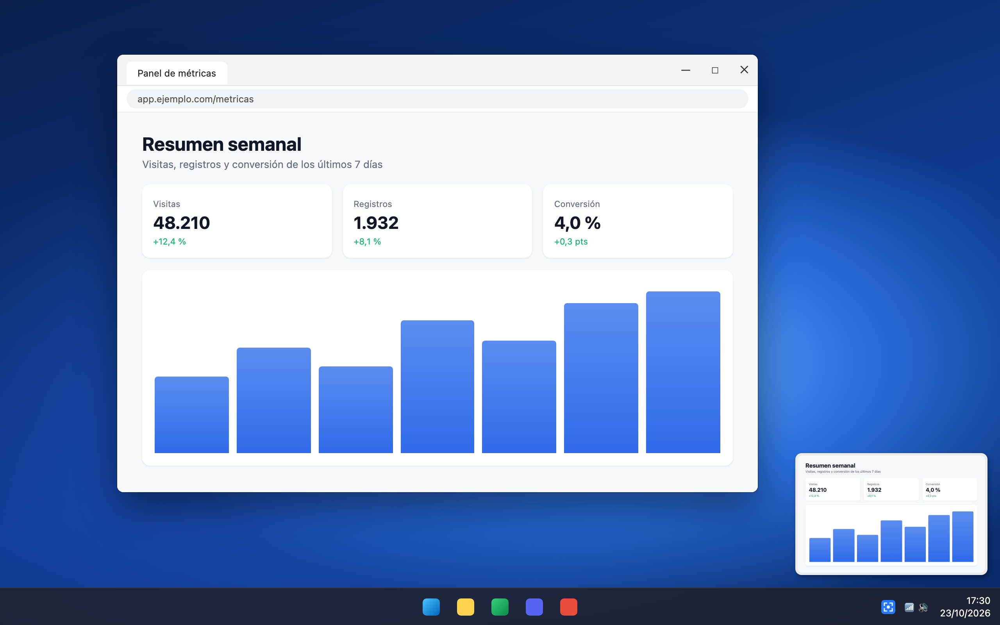
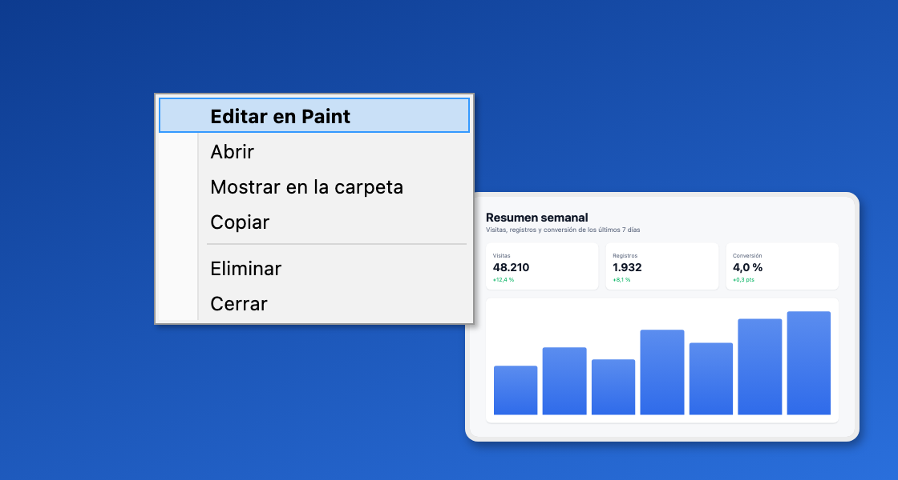
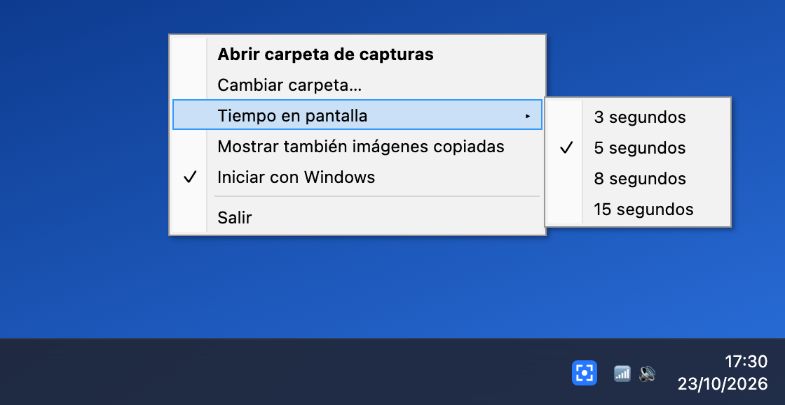

# Captura flotante para Windows

La miniatura flotante de las capturas del Mac, en Windows 10/11.



**[Descargar la última versión](../../releases/latest)** (`CapturaFlotante.zip`, 32 KB)

Haz una captura como siempre (**Win+Shift+S** o **Impr Pant**) y aparece una miniatura abajo a la derecha:

- **Arrastrarla** a una carpeta, un chat (Discord, WhatsApp, Slack…), un correo o el navegador suelta el archivo PNG. Como en el Mac, la miniatura viaja pegada al cursor, y los programas que no aceptan archivos reciben la imagen.
- **Clic** la abre en Paint para editarla.
- **Deslizarla a la derecha** la quita.
- **Clic derecho**: Abrir, Mostrar en la carpeta, Copiar, Eliminar.
- Con el ratón encima no se va. Si la dejas, desaparece a los 5 segundos y la captura se queda guardada.

Las capturas se guardan en el **Escritorio** con nombre `Captura de pantalla 2026-10-23 a las 17.30.32.png`. La carpeta y la duración se cambian desde el icono junto al reloj.

| Clic derecho en la miniatura | Menú del icono junto al reloj |
|---|---|
|  |  |

> Las imágenes son recreaciones con las mismas medidas que dibuja la app (`herramientas/maqueta`), no capturas de un Windows real.

## Instalación

1. Descomprime `CapturaFlotante.zip` donde quieras (por ejemplo, `Documentos\CapturaFlotante`).
2. Abre `CapturaFlotante.exe`. Si sale "Windows protegió su PC", pulsa *Más información* y luego *Ejecutar de todas formas* (el exe no está firmado).
3. En el icono junto al reloj, marca **Iniciar con Windows**.

No necesita instalar nada más: usa .NET Framework 4.8, que ya trae Windows.

## Recomendado

- Para no ver dos avisos a la vez: *Configuración > Sistema > Notificaciones > Herramienta Recortes* → desactivado.
- Si Recortes ya guarda las capturas solo (*Recortes > Configuración > Guardar automáticamente*), desactívalo para no tenerlas duplicadas, o apunta Captura flotante a la misma carpeta y desactiva una de las dos.

## Compilar

```
dotnet build -c Release
```

Compila también desde macOS/Linux (usa `Microsoft.NETFramework.ReferenceAssemblies`). El exe queda en `bin/Release/net48/`.

Las imágenes del README se regeneran con `node herramientas/maqueta/capturar.mjs <ruta absoluta a maqueta.html> docs` (necesita `playwright-core`).
